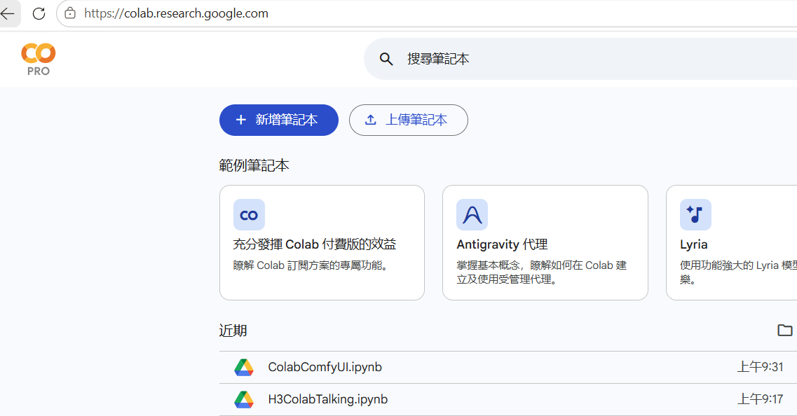
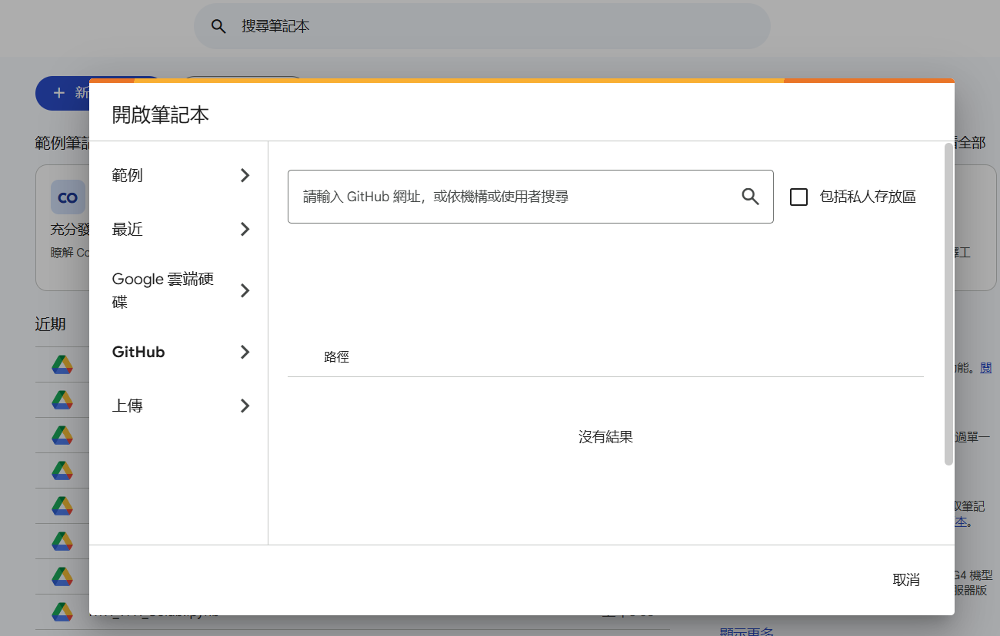
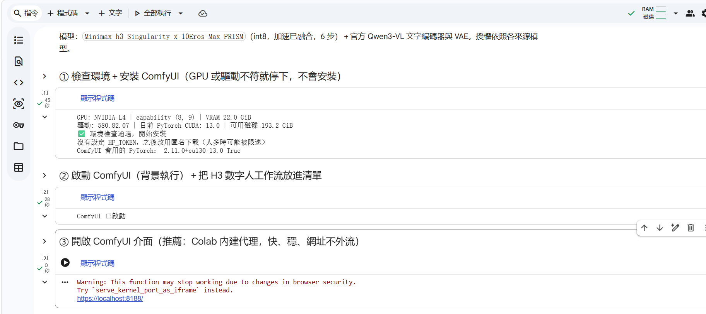
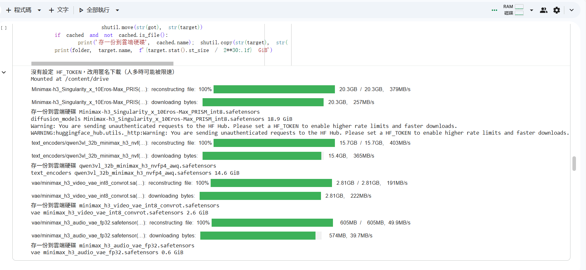
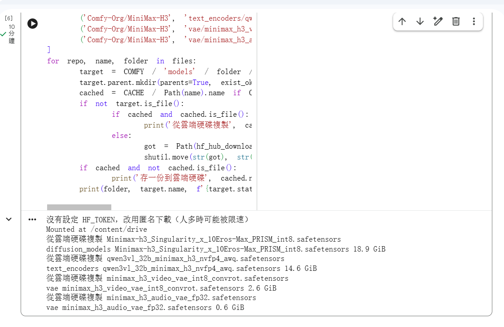
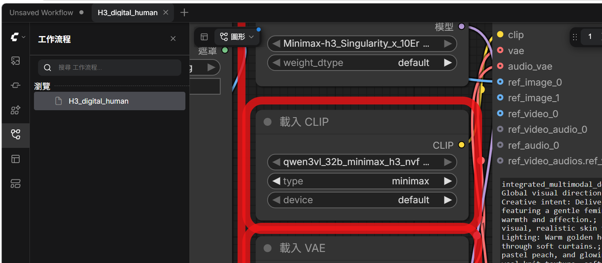
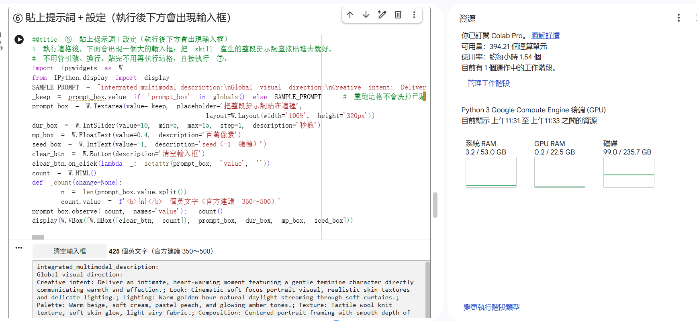

# MiniMax H3 × ComfyUI on Google Colab

在 Google Colab 上用 L4 GPU 跑 **MiniMax H3**（影音一起生成的影片模型），不用自己的顯卡。
只要有 **Google AI Pro** 訂閱（附 Colab 運算單元）就能上手。

| 筆記本 | 用途 | 開啟 |
|---|---|---|
| **H3_Basic_ComfyUI** | 基礎學習：裝好 ComfyUI＋H3 模型組，**不帶工作流**，自己拉節點 | [](https://colab.research.google.com/github/dseditor/minimax-h3-colab/blob/main/H3_Basic_ComfyUI.ipynb) |
| **H3_Digital_Human** | 數字人：一張人物照＋一段提示詞 → 會說話的影片；也可以交給桌面版 AI 用 skill 生成 | [](https://colab.research.google.com/github/dseditor/minimax-h3-colab/blob/main/H3_Digital_Human.ipynb) |

> 一律從上面的按鈕開啟：筆記本改版只要更新這個 repo，按鈕永遠開到最新版，不必再傳新的分享網址。

---

## 需要準備

- **Google AI Pro 訂閱**（Colab Pro 的運算單元）。L4 約每小時 1.5 個運算單元。
- 執行階段選 **L4 GPU**。A100 也能跑但很耗點數；**T4 跑不動**（int8 模型需要 compute capability 8.0 以上）。
- （建議）**Hugging Face 唯讀權杖**：左側欄「🔑 密鑰」新增 `HF_TOKEN`，並開啟「筆記本存取權」。沒有也能下載，只是人多時可能被限速。

## L4 實測時間

| 步驟 | 時間 |
|---|---|
| ① 檢查環境＋安裝 ComfyUI | 約 45 秒 |
| ② 啟動 ComfyUI | 約 30 秒 |
| ④ 下載模型（約 37 GB） | 約 1 分鐘 |
| 生成 10 秒影片（0.4 百萬像素） | 約 4 分鐘 |

---

## 操作步驟

### 1. 開啟筆記本

點上方表格的 **Open in Colab**。也可以在 Colab 首頁按「開啟筆記本 → GitHub」，搜尋 `dseditor/minimax-h3-colab`。




開啟後先到「執行階段 → 變更執行階段類型」選 **L4 GPU**。

### 2. 由上往下執行 ①②③

- **①** 先檢查 GPU 與驅動，不符合就直接停下、不會安裝任何東西；通過才安裝 ComfyUI（CUDA 13 版 PyTorch、節點管理器、[ListHelper](https://github.com/dseditor/ComfyUI-ListHelper) 節點組）。
- **②** 在背景啟動 ComfyUI。
- **③** 用 Colab 內建代理開啟介面：下方出現的連結顯示成 `localhost` 也沒關係，**直接點它**。



> ③ 需要瀏覽器登入**跟 Colab 同一個 Google 帳號**。帳號不同、或要把介面交給 AI 操作時，改用 **③-b**（cloudflare 網址）。
> ⚠️ ③-b 的網址沒有密碼，拿到的人都能用你的 GPU，不要貼到公開的地方。

### 3. ④ 下載模型

ComfyUI 確認正常之後才下載，避免裝壞了還白抓 37 GB。



`USE_DRIVE_CACHE` 預設不勾：直接從 Hugging Face 下載最快。只有撞到 HF 流量上限時才勾選，改從「我的雲端硬碟/H3_models」複製（第一次會順便存一份）。



### 4a. 基礎版：開始玩 ComfyUI

到這裡就裝好了。在介面裡拉節點、或把自己的工作流 JSON 拖進畫面。節點管理器已開啟，可以自由安裝自訂節點。

### 4b. 數字人版：⑤ 上傳照片 → ⑥ 貼提示詞 → ⑦ 生成

數字人筆記本的 ② 會把工作流放進 ComfyUI 左側的工作流清單，想看節點可以直接點開。



- **⑤** 上傳一張人物照。
- **⑥** 執行後下方出現大輸入框，把整段提示詞直接貼進去（不用管引號、換行），並設定秒數（5～15）、解析度、seed。重跑這格不會洗掉已貼的內容。
- **⑦** 生成，完成後在筆記本裡播放並自動下載。



提示詞要照 MiniMax 官方的 Ref2VA 格式寫（英文本文、台詞保留原文）。可以請 AI 用官方 [`h3-prompt-writing`](https://github.com/MiniMax-AI/MiniMax-H3/tree/main/.claude/skills/h3-prompt-writing) skill 產生。

---

## 交給桌面版 AI：`h3-colab-digital-human` skill

`skills/h3-colab-digital-human/` 讓能執行本機 PowerShell（或 Python）的桌面版 AI（Claude Desktop、ChatGPT Desktop 等）直接幫你生成：

1. 你在 Colab 跑 **①、②、③-b、④**（兩本筆記本都可以），把 ③-b 的網址交給 AI。
2. 給 AI 一張人物照的路徑和一句中文需求（說什麼、什麼語氣、幾秒）。
3. AI 看照片寫提示詞 → 透過 ComfyUI API 上傳、生成、下載影片到你的電腦。

安裝：把 `skills/h3-colab-digital-human` 整個資料夾放進 AI 的 skills 目錄。官方提示詞指南不隨本 repo 散布，skill 會引導 AI 從 MiniMax 官方 repo 下載（見 `references/H3_NOTICE.md`）。

---

## 模型

| 檔案 | 來源 | 大小 |
|---|---|---|
| `Minimax-h3_Singularity_x_10Eros-Max_PRISM_int8` | [OliviaRossi/Minimax-h3_Singularity-x-10Eros-Max_PRISM](https://huggingface.co/OliviaRossi/Minimax-h3_Singularity-x-10Eros-Max_PRISM) | 18.9 GB |
| `qwen3vl_32b_minimax_h3_nvfp4_awq` | [Comfy-Org/MiniMax-H3](https://huggingface.co/Comfy-Org/MiniMax-H3) | 14.6 GB |
| `minimax_h3_video_vae_int8_convrot` | Comfy-Org/MiniMax-H3 | 2.6 GB |
| `minimax_h3_audio_vae_fp32` | Comfy-Org/MiniMax-H3 | 0.6 GB |

主模型是 int8 融合模型，加速已融合，6 步出片，不需要另外掛 LoRA。各模型授權依照其來源。

## 踩過的坑（筆記本裡已處理）

| 症狀 | 原因 | 處理 |
|---|---|---|
| cloudflare 網址開介面顯示「存取遭拒」403 | 瀏覽器 Origin 與轉進來的 Host 對不上 | 啟動加 `--enable-cors-header` |
| cloudflare 網址卡在載入畫面 | 通道輸出接 PIPE 沒人讀，塞滿就停 | 輸出改寫進檔案 |
| Colab 代理下點開工作流清單出現 404 | 代理把網址裡的 `%2F` 解開，路徑變兩段 | 預裝一個補路由的小節點（`tools/userdata_slash_fix.py`） |
| 驅動版本太舊 | int8 ConvRot 需要 CUDA 13（驅動 580 以上） | ① 先檢查，不符就停下 |

## 給維護者

兩本筆記本由 `tools/build_notebooks.py` 產生，**不要直接改 ipynb**：

```bash
python tools/build_notebooks.py
```

- `workflows/H3_digital_human.json`：ComfyUI 介面格式工作流
- `workflows/H3_digital_human_api.json`：API 格式（⑦ 與 skill 用）
